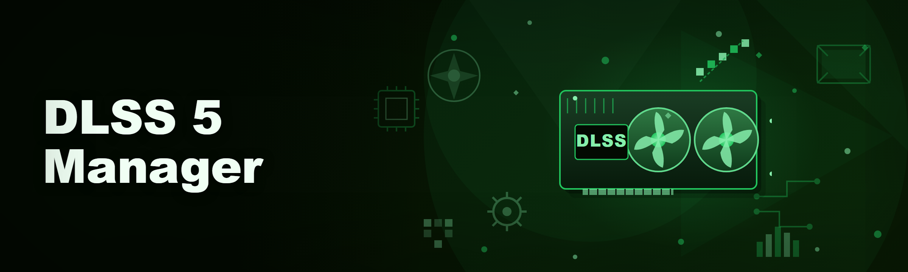
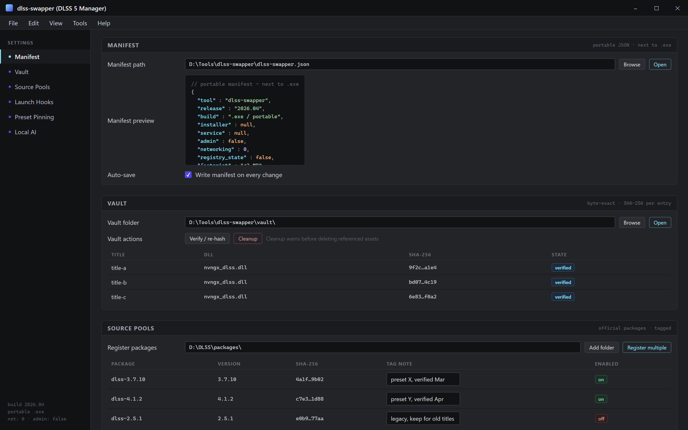
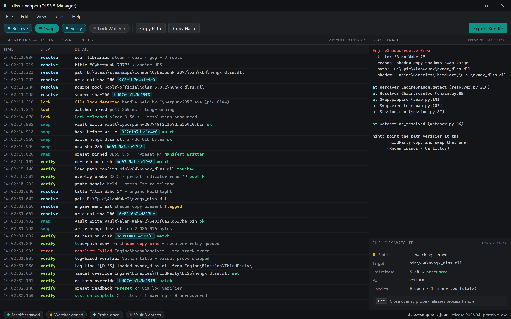

  
  
  

  

  
  

---

**DLSS 5 Manager** for 2026 is a small native Windows tool that swaps the DLSS DLL that a game actually loads — nothing more, nothing less. The repo is called `dlss-swapper` because that's the literal job: drop the official NVIDIA DLL from a newer package into a title that shipped with an older preset, and revert cleanly when a patch breaks things.

I built this after six months of fighting paid "DLSS managers" that locked preset selection behind a subscription, phoned home on every launch, or silently upgraded every game on the machine without asking. This one is free, stays offline, and only touches the specific DLL a specific title loads from its own folder.

> Educational and modding use only. You are responsible for what you swap in your own install directories. Some multiplayer titles treat any DLL change as tampering — read their ToS before you touch them.

---

## 📖 Overview

| Category | Details |
|---|---|
| Scope | Per-game DLSS DLL replacement, preset pinning, and clean restore |
| Distribution | Portable `.exe` — download, extract, run. No installer, no service, no admin by default |
| Storage | Plain JSON manifest next to the `.exe` — no registry writes for game state |
| Backups | Byte-exact original DLLs stored in a per-game vault before any write |
| Compatibility | DLSS 2.x / 3.x / 4.x DLL ABI; DLSS 5 presets exposed as of the 5.x line |
| Footprint | Under 3 MB on disk, no runtime deps beyond the MSVC redist (already on Win10/11) |
| Networking | Zero. It doesn't download presets, DLLs, or telemetry |

The 2026 build is a rewrite of the 2024 fork: the launcher stubs are gone, the scan is a single directory-walk pass instead of a WMI sweep, and the `.exe` no longer bundles a runtime someone forgot to remove. It starts in under a warm-cache second on a mid-range rig.

---

## 🚀 Quick Start

1. 💾 Head to the project page and grab the current `.exe` build.
2. 📦 Extract the archive to any folder you control — a games-tools drive is fine.
3. 🖥️ Double-click the `.exe`. SmartScreen will warn on an unsigned build; allow it.
4. 🔍 Click **Scan** and let it enumerate the Steam / Epic / GOG libraries it detects.
5. 🎛️ Pick a title, pick a DLL source, hit **Swap**, then **Launch** to confirm the load in-game.

That's the whole loop. Presets, backups, and restore are under the same window.

Everything is a file next to the .exe — manifest, vault, pools, hooks. No registry, no service, no network.

  

---

## 🎯 Key Features

| Feature | Description | Benefit |
|---|---|---|
| Byte-exact vault | SHA-256 of every original DLL stored before write | One-click restore, patch-proof |
| Preset pinning | Overrides the "latest preset" default to a named generation | Stop re-testing presets every patch |
| Per-title profiles | Each game gets its own record: path, backup, preset, notes | No cross-contamination between titles |
| DLL source pools | Register multiple official DLSS packages, tag them, pull per game | Keeps old versions available |
| Load-path verifier | Reports which DLL path the process map confirms it touches | Catches engines that shadow the swap |
| Overlay probe | Reads the in-game preset indicator without dying on Vulkan | Lets you verify presets visually |
| Portable manifest | JSON state you can diff, back up, and copy between machines | No database, no lock-in |
| Launch hooks | Optional pre/post launch automation via simple batch handoff | Fits existing launch scripts |
| Preset notes log | Per-game timestamped record of what you tried and what changed | No more "which preset did this work on?" |
| Engine-agnostic scan | UE, Unity, Source, bespoke C++ builds | Works where the DLL actually sits |

  

---

## ⌨️ Hotkeys / Controls

| Key | Action | Notes |
|---|---|---|
| Ctrl+R | Rescan libraries | Safe while games are closed |
| Ctrl+F | Focus search / filter | Matches title and folder name |
| Ctrl+B | Snapshot backup column | Multi-select the vault assets |
| Ctrl+S | Write manifest | Auto-saves too, this is the manual nudge |
| Ctrl+Enter | Swap and launch | Skips the confirmation dialog |
| F5 | Refresh selected title | Re-reads the DLL path and preset |
| F2 | Rename profile | Profiles aren't tied to display names |
| Esc | Close the overlay probe | Releases the process handle |

---

## ⚠️ Usage Guidelines

| Use Case | Allowed | Not allowed |
|---|---|---|
| Personal library, offline | ✅ | |
| Single-player mod testing | ✅ | |
| Comparing preset quality across versions | ✅ | |
| Backups and clean restore | ✅ | |
| Anti-cheat-protected multiplayer | | ❌ Refused by policy |
| Redistributing original DLSS DLLs | | ❌ Never, official sources only |
| Bypassing NVIDIA EULA / DRM checks | | ❌ Out of scope |
| Automating swaps into titles you don't own | | ❌ See above |

---

## 📋 Changelog / Release History

| Version | Date | Changes |
|---|---|---|
| 2026.04 | 2026-04 | Preset pinning supports the DLSS 5.x line; verified-load checks added |
| 2026.03 | 2026-03 | Rewrote DLL scan; retired the launcher stub; portable manifest v2 |
| 2026.02 | 2026-02 | Vault hash-before-write; per-title profile notes |
| 2026.01 | 2026-01 | First 2026 build; dropped bundled runtime; single binary |
| 2025.11 | 2025-11 | Retired 2024 fork's WMI sweep; added GOG library detection |

No semantic version numbers — versions are date-based, so a rebuild today is obvious in the manifest.

---

## 🌐 Community & Support

- **Issues**: bug reports and per-title compatibility notes belong in the repo's Issues tab — include the `.exe` version, the title, and the DLL path you shared.
- **Discussions**: questions about presets, DLL sourcing, and engine quirks live here. Moderation is loose but stick to solving each other's problems.
- **Wiki**: maintained notes per engine — UE5, UE5.4+, Unity 6, Source 2 — including which DLL path each engine actually loads.
- Not affiliated with NVIDIA, Steam, Epic, or GOG. DLLs must come from official sources.

---

## 🩹 Known Issues

| Issue | Fix |
|---|---|
| Swap appears to do nothing in UE titles | The engine loads from `Engine\Binaries\ThirdParty\...` — point the path verifier there and swap that copy |
| Overlay probe doesn't render on Vulkan | Use the log-based verifier; DX12-only titles get the visual probe |
| Steam patch reverts a preset | Relaunch the `.exe` and re-apply — the vault keeps the last known-good hash |
| SmartScreen blocks every build | It's unsigned; stay consistent, allow it once per download |
| Two titles using the same DLL stem | The manager separates by full path; same-stem conflicts are flagged in the record |
| Restore fails on locked file | Close the title; the manager won't touch inherited handles |

---

## 💾 Installation

1. **Download the build.** Go to the project page and use 

  

. There is no installer — the packet is an archive with the `.exe` and a sample manifest.
2. **Extract anywhere writable.** Avoid `Program Files`; use a dedicated folder so the vault has room to grow. Windows Defender often flags unsigned bundles; allow this build.
3. **Run the `.exe`.** No admin prompt. First launch scans available libraries read-only. If a title isn't found, add its root folder manually.

--- 

## 🧩 Module Catalog

**DLL Path Resolution**

*The resolver is the piece that surprises people most; it uses the process map, the engine manifest, and a manual override chain.*

- Fixed set of engine-specific resolvers shipped
- Manual path override per title
- Explains why a swap didn't take
- Read-only detection pass before any write
- Confirms the loaded DLL after swap

**Per-Title Profiles**

*Every title gets a mutable record keyed on a stable internal ID, not display name.*

- Backup hash and original path stored
- Preset label, DLL source, and notes per entry
- Import/export profile JSON for machine moves
- Tagging (single-player, VR, benchmark)
- Friendly rename that never affects paths
- Last known return value for silent games

**DLSS Source Pools**

*A pool is a folder of tagged DLL sources; pools can hold multiple packages and versions.*

- Register multiple packages at once
- Per-DLL tag notes ("preset X, verified Mar")
- SHA-256 visible per source
- Source can be disabled from picker
- Two-way diff against the installed DLL

**Backup Vault**

*The vault is byte-exact — same bytes, same friendly name, no renames after write.*

- SHA-256 per entry, stored alongside bytes
- Verify call: re-hash and compare against the record
- Deduplicate identical rows via content hash
- "Open in Explorer" won't silently mutate
- Cleanup warns before deleting anything referenced

**Preset Pinning & Verification (5.x-aware)**

*The preset override is local — it selects among available DLSS 5 presets without touching NVIDIA's globals.*

- Named preset labels pinned per title
- Probe reads the game's loaded preset back out
- Preset flag written in the manifest, not the registry
- Known-bad combos surfaced from community list
- Regression cross-check on every preset swap

**Diagnostics**

- Single-window log of resolve, swap, and verify steps
- Stack trace captured if a resolver errors
- Export a diagnostic bundle for the Issues tab
- Readable hash rows (not just log strings)
- Long-running file-lock watcher that announces resolution

Resolve, swap, verify — every step logged with readable hashes; export the bundle when a swap doesn't take.

---

## 🗺️ Roadmap / Planned Features

| Feature | Status | ETA |
|---|---|---|
| Multi-DLL groups (DLSS + ray reconstruction + frame-gen) as one unit | Planned | Q3 2026 |
| Cloud-neutral profile sync via a JSON gist | Planned | Q3 2026 |
| Linux/WINE path resolver | Exploring | Q4 2026 |
| UI-less CI mode for scripted bench runs | Planned | Q4 2026 |
| Preset confidence scoring using in-game session data | Exploring | 2027 |
| Shader stack report per title | Backlog | — |
| Third-party DLL signature watcher (official-only) | Backlog | — |

---

## 🎯 The Problem

- Paid alternatives gate the only thing that actually matters — preset choice — behind subscriptions.
- Bundled launchers secretly re-swap every game every launch, and you can't see the patched set easily.
- Fixing a swap again after every Steam patch has no built-in undo, ever.
- "Which preset made shadows pop and which made them mush" runs out of file space way too fast.
- Anti-cheat titles still ship inside payload bundles from "free" managers — this is where a stable tool actually helps.
- Nobody keeps a byte-exact hash of what they replaced, so "restore" is really just hanging a random old file back.

---

## 🧠 AI Integration (Does It Belong Here?)

DLSS 5 Manager itself doesn't phone home and the `.exe` has no network access. The 2026 fit is in two optional AI features that run locally:

- **Preset advisor** — you mark 3 cards "this felt smooth" and 5 "this looked ratchet"; the tool fits you a preset-weight suggestion based on titles/IPs you've already recorded. Entirely on-file, no account.
- **Path explainers** — the AI model, loaded from a local model file you drop in, reads a diagnostic bundle and says "the engine actually loads a file from this second path" instead of me writing another wiki page.
- **Swap-coverage audit** — it names which subset of a title's DLLs you replaced, so it's not all-or-nothing guessing.

If you don't put a model file in the folder, all of this is visible UI but greyed out. The `.exe` has no requirement that any model exists.

---

## ❓ FAQ

<b>Is the <code>.exe</code> safe to run if SmartScreen flags it?</b>

It's unsigned — that's the entire story. There's no network stack, no installer, no service, and no scheduled task. Allow it once per download; if you decide not to, delete the folder and try an older build from the repo.

<b>Where does it store backups?</b>

Next to the `.exe`, in a `vault/` folder you control. Move the folder, move the vault. There's no registry state, no per-user runtime, no service caching.

<b>Why is my swap not registering?</b>

Most likely the title loads from a different copy than the one you addressed. Turn on the verifier, launch the game, and open the diagnostic panel. Rare case: DLL is locked by an inherited handle from a prior run.

<b>Will this get me banned in a multiplayer game?</b>

Don't take this to anti-cheat-protected multiplayer. That's the one rule in this repo. Single-player and benchmark use the vault without tou

[…truncated for layout…]